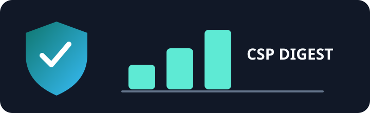

  
  
  
  

## 🔎 Overview
A dependency-free Node.js CLI for summarizing saved Content Security Policy (CSP) violation reports. It accepts legacy csp-report records and Reporting API-style records, then groups violations into a compact local report. It never contacts a remote endpoint.

## ✨ Features
- 🧾 Reads JSON arrays, single JSON objects, and JSON Lines files
- 🛡️ Groups reports by effective directive and disposition
- 🔒 Reduces HTTP(S) resource URLs to origin and path to avoid printing query strings or fragments
- 📊 Emits a readable terminal summary or machine-readable JSON

## 🎬 Demo
No hosted demo is published. Try the included sample file locally:

    node src/cli.js examples/reports.jsonl

## 🚀 Quick Start
Requires Node.js 18 or newer. No package installation is required.

    git clone https://github.com/CyberLoop-dev/csp-report-digest.git
    cd csp-report-digest
    npm start -- examples/reports.jsonl

To analyze your own report export:

    node src/cli.js ./csp-reports.jsonl --json

## 🧰 Tech Stack
- Node.js 18+
- JavaScript ES modules
- Node.js built-in test runner

## 🗂️ Folder Structure
    src/                 Parser and CLI
    test/                Parser tests
    examples/            Small sample report set
    assets/              README illustration
    package.json         Scripts and project metadata

## 🛣️ Roadmap
- [ ] Add CSV output
- [ ] Add optional grouping by source file
- [ ] Support streamed input for very large JSONL exports

## 🤝 Contributing
Issues and pull requests are welcome. Keep parsing local, preserve privacy by default, and add tests for new report shapes.

## 📄 License
Released under the MIT License. See LICENSE.

